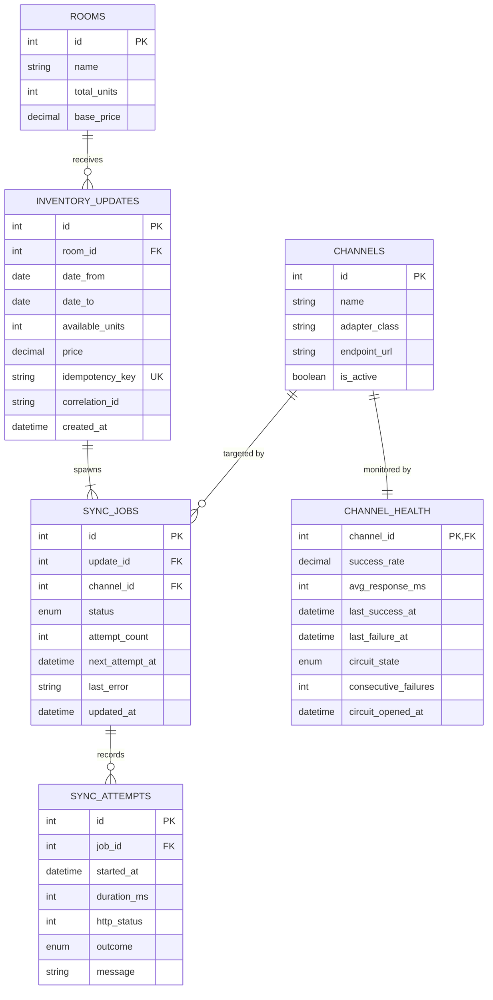
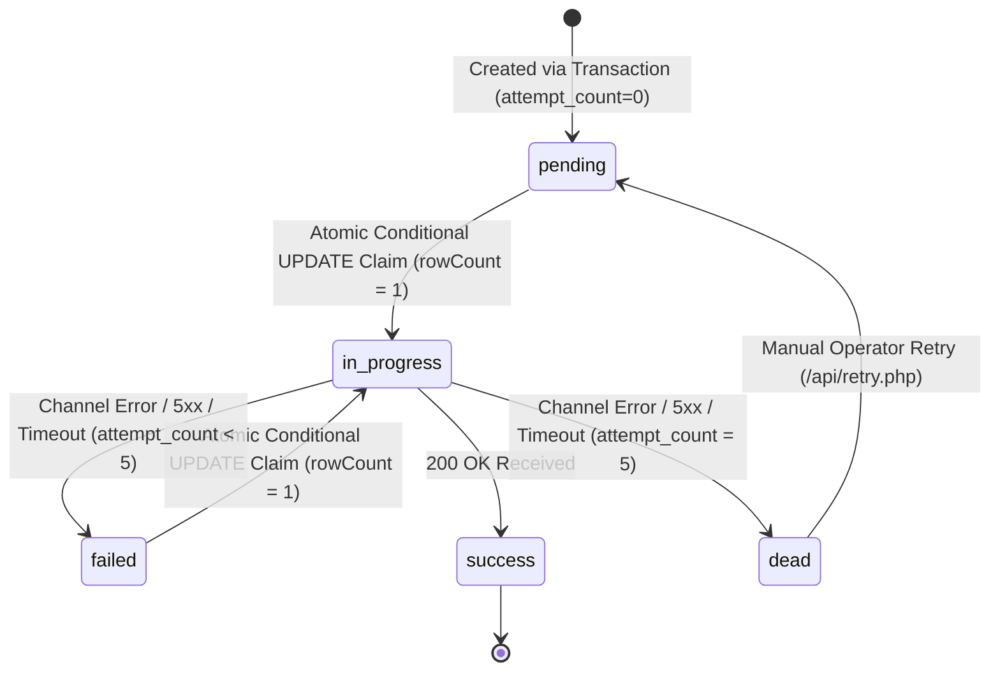
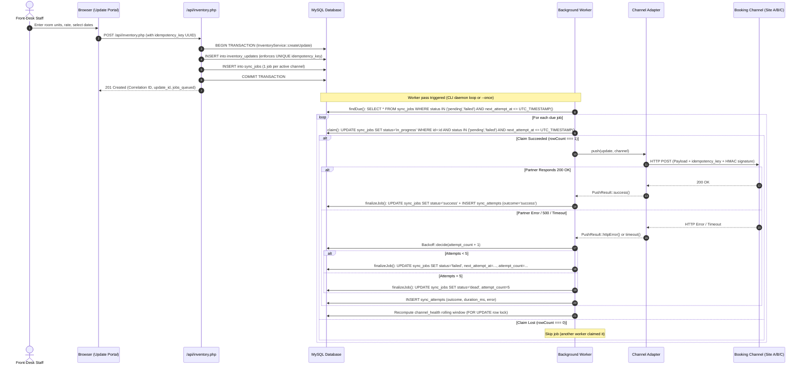

# Sync Guard Architecture & System Design

Sync Guard is an asynchronous multi-channel hotel inventory distribution engine designed to prevent double-bookings, ensure consistent room availability across Online Travel Agencies (OTAs), and gracefully handle intermittent third-party channel outages.

---

## 1. High-Level System Architecture

### Architectural Columns

1. **Front-Desk Staff & Operations:** Interacts via responsive web interfaces (`/update.php`, `/index.php`, `/log.php`). Submits inventory updates protected by client-generated UUIDv4 idempotency keys.
2. **Web Application Layer (`public/` & `src/`):** Lightweight, zero-framework PHP 8.2 backend serving HTML5/CSS3/Vanilla JS frontends and JSON REST endpoints (`/api/inventory.php`, `/api/status.php`, `/api/jobs.php`).
3. **Storage & Queue Engine (`MySQL 8.0`):** Single-transaction persistence boundary. When an inventory update is submitted, both the update record and all child channel distribution jobs are committed in a single ACID transaction (`InventoryService::createUpdate`).
4. **Autonomous Queue Worker (`bin/worker.php`):** CLI background process that continuously polls due jobs and claims them via an atomic conditional `UPDATE` query (`JobRepository::claim`). Manages exponential backoff schedules, logs attempt telemetry, and records heartbeat state.
5. **Channel Adapters & Partner Mock Channels:** Pluggable adapter layer (`src/Adapters/ChannelAdapter.php`) transforming generic hotel inventory changes into channel-specific protocols (REST JSON with Bearer tokens, XML with custom schemas, rate-limited APIs).

---

## 2. Core Database Schema

Sync Guard models inventory synchronization using five normalized, indexed InnoDB tables in UTC:

> **Note on Schema Columns:** In `channel_health`, the columns `circuit_state` and `circuit_opened_at` exist in the table schema from initial design but are intentionally unused in the codebase (no circuit breaker is implemented).

---

## 3. Asynchronous Job Lifecycle & State Machine

### State Definitions

- **`pending`**: Job is queued and waiting for worker processing. `status = 'pending' AND next_attempt_at <= UTC_TIMESTAMP()`.
- **`in_progress`**: Claimed by a worker pass via atomic conditional `UPDATE` setting `status = 'in_progress', updated_at = UTC_TIMESTAMP()`.
- **`success`**: Successfully transmitted and verified by the partner booking channel. Terminal state.
- **`failed`**: Transmission failed on attempts 1 through 4. Scheduled for future retry according to the exponential backoff schedule with jitter (`next_attempt_at` advanced).
- **`dead`**: Failed 5 attempts. Ceases automated retries. Requires manual operator inspection and retry via `/api/retry.php`.

---

## 4. End-to-End Delivery Sequence

---

## 5. Reliability & Defense Mechanisms

1. **Transactional Outbox Guarantee:** The application never writes inventory updates without creating all matching channel distribution jobs in the same MySQL transaction (`InventoryService.php:88-120`).
2. **Atomic Conditional Claiming:** Workers do not use OS `flock` or `SKIP LOCKED` on jobs. Instead, `JobRepository::claim()` executes a single conditional `UPDATE` matching `id`, `status IN ('pending', 'failed')`, and `next_attempt_at <= UTC_TIMESTAMP()`. `rowCount() === 1` guarantees exactly one worker wins.
3. **Exponential Backoff with Jitter:** Retries occur on a 4-interval schedule: **60s, 300s, 900s, 3600s** (`src/Retry/Backoff.php:38-43`). A configurable random jitter of `+/- RETRY_JITTER_PERCENT` (default 10%) prevents thundering herd synchronization. The 5th failure marks the job `dead`.
4. **Idempotency Everywhere:**
   - Intake: Front-end generates a UUIDv4 stored in `inventory_updates.idempotency_key` with a `UNIQUE` index. Duplicate submissions return HTTP 200 with the original result without re-inserting.
   - Outbound: Channel adapters forward the client's `idempotency_key` (or transaction ID) in HTTP payloads and headers so external OTAs deduplicate retries.
   - Delivery guarantee: Delivery is **at-least-once**, made completely safe by idempotency.
   - HMAC signatures (`X-Signature: sha256=...`) authenticate request payload integrity against tampering and are a completely separate mechanism from idempotency.
5. **Rolling Window Channel Health Scoring:** Evaluated dynamically across the last 50 attempts (`DEFAULT_WINDOW_ATTEMPTS = 50`) using `HealthService::labelFor`:
   - `no_data`: Zero attempts recorded.
   - `down`: `consecutive_failures >= 5`.
   - `degraded`: `consecutive_failures >= 2`, OR (`consecutive_failures >= 1 AND success_rate < 90.0%`).
   - `recovering`: `consecutive_failures == 0`, `success_rate < 90.0%`, and `recentSuccessStreak < 5`.
   - `healthy`: `success_rate >= 90.0%` with 0 consecutive failures, OR `recentSuccessStreak >= 5`.
6. **Dynamic At-Risk Calculation:** Rooms with unsynchronized jobs (`status != 'success'`) on active channels are calculated dynamically at query time in `StatusService::calculateAtRiskRooms()`. No static `is_at_risk` boolean is stored on the `rooms` table.
7. **Intentional Limitations:** No authentication, CSRF protection, roles, or audit logging are implemented (documented educational scope). No circuit breaker logic is active (`circuit_*` columns are unused).
